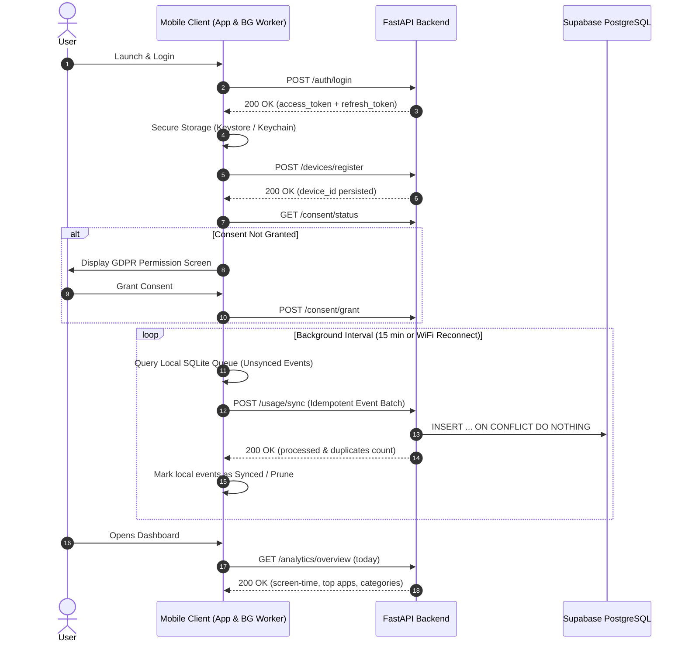

# Mobile Client API Specification & Integration Contract

**Target Clients**: Android (Kotlin/Flutter) & iOS (Swift/Flutter)  
**API Version**: `v1`  
**Base URL**: 
- **Production / Staging**: `https://api.yourdomain.com/api/v1`
- **Local Dev (Android Emulator)**: `http://10.0.2.2:8000/api/v1`
- **Local Dev (iOS Simulator)**: `http://localhost:8000/api/v1`
- **Local Dev (Physical Device on Wi-Fi)**: `http://<HOST-IP>:8000/api/v1`

---

## Table of Contents
1. [Architectural Overview & Mobile Flow](#1-architectural-overview--mobile-flow)
2. [Global Request / Response Protocol](#2-global-request--response-protocol)
3. [Authentication & Session Lifecycle](#3-authentication--session-lifecycle)
4. [Device Registration & Hardware Heartbeat](#4-device-registration--hardware-heartbeat)
5. [Privacy, Permissions & Consent Management (GDPR Mandatory)](#5-privacy-permissions--consent-management-gdpr-mandatory)
6. [Usage Telemetry Sync Engine (Core Pipeline)](#6-usage-telemetry-sync-engine-core-pipeline)
7. [Dashboard & Analytics Consumption](#7-dashboard--analytics-consumption)
8. [App Limits, Goals & Guardrails](#8-app-limits-goals--guardrails)
9. [Mobile Client Implementation Guidelines](#9-mobile-client-implementation-guidelines)

---

## 1. Architectural Overview & Mobile Flow

The mobile client operates as a background telemetry collector and foreground digital wellbeing dashboard:



---

## 2. Global Request / Response Protocol

### 2.1 HTTP Headers
All authenticated mobile requests MUST provide:
```http
Authorization: Bearer <JWT_ACCESS_TOKEN>
Content-Type: application/json
Accept: application/json
```

### 2.2 Standard Error Response Shape
Every error returned by the backend follows this unified JSON schema:
```json
{
  "error": {
    "code": "UNAUTHORIZED | VALIDATION_ERROR | CONFLICT | NOT_FOUND | FORBIDDEN | INTERNAL_SERVER_ERROR",
    "message": "Human-readable explanation of the error",
    "details": [] 
  }
}
```

### 2.3 Token Expiration Policy
- **Access Token TTL**: 15 minutes (`expires_in: 900`).
- **Refresh Token TTL**: 30 days.
- **Handling**: When any endpoint responds with `401 Unauthorized` and `"code": "UNAUTHORIZED"`, the mobile HTTP interceptor must pause outgoing requests, trigger `POST /auth/refresh`, update local tokens, and retry the original failed request.

---

## 3. Authentication & Session Lifecycle

### 3.1 Register User Account
Create a new user account with timezone detection.
- **Method**: `POST`
- **Endpoint**: `/auth/register`
- **Auth**: None

#### Request Body
```json
{
  "email": "sarah.connor@example.com",
  "password": "StrongPassword123!",
  "display_name": "Sarah Connor",
  "timezone": "America/New_York"
}
```
*Tip: Retrieve `timezone` dynamically on mobile via `flutter_timezone` or `TimeZone.current.identifier` (e.g., `"America/New_York"` or `"Asia/Kolkata"`).*

#### Response (`201 Created`)
```json
{
  "user_id": "9b1deb4d-3b7d-4bad-9bdd-2b0d7b3dcb6d",
  "email": "sarah.connor@example.com",
  "display_name": "Sarah Connor",
  "timezone": "America/New_York",
  "created_at": "2026-11-21T06:00:00Z"
}
```

---

### 3.2 Login (Authenticate)
Obtain initial JWT access token and rotating refresh token.
- **Method**: `POST`
- **Endpoint**: `/auth/login`
- **Auth**: None

#### Request Body
```json
{
  "email": "sarah.connor@example.com",
  "password": "StrongPassword123!"
}
```

#### Response (`200 OK`)
```json
{
  "access_token": "eyJhbGciOiJIUzI1NiIsIn...",
  "refresh_token": "d748f328-1f6b-4e1b-b467-11ef85966df3",
  "token_type": "bearer",
  "expires_in": 900
}
```
*Action*: Save `access_token` and `refresh_token` in `flutter_secure_storage` or EncryptedSharedPreferences (Android) / Keychain (iOS).

---

### 3.3 Silent Token Refresh
Rotates the refresh token and yields a fresh 15-minute access token.
- **Method**: `POST`
- **Endpoint**: `/auth/refresh`
- **Auth**: None

#### Request Body
```json
{
  "refresh_token": "d748f328-1f6b-4e1b-b467-11ef85966df3"
}
```

#### Response (`200 OK`)
```json
{
  "access_token": "eyJhbGciOiJIUzI1NiIsIn...",
  "refresh_token": "a1990c74-2e91-49fa-8cc8-31be1d4a0f44",
  "token_type": "bearer",
  "expires_in": 900
}
```
*Note: Refresh tokens are single-use and automatically rotated. Replace the stored refresh token with the newly issued one.*

---

## 4. Device Registration & Hardware Heartbeat

### 4.1 Register / Heartbeat Device
Invoked immediately after login and during app launch to register the physical phone and record connectivity.
- **Method**: `POST`
- **Endpoint**: `/devices/register`
- **Auth**: Required (`Bearer <access_token>`)

#### Request Body (Full)
```json
{
  "device_identifier": "11111111-2222-3333-4444-555555555555",
  "platform": "android",
  "device_model": "Google Pixel 8",
  "os_version": "Android 14 (API 34)",
  "app_version": "1.0.0",
  "capabilities": {
    "supports_network_tracking": true,
    "supports_app_shielding": false,
    "has_usage_permission": true,
    "has_screen_time_permission": false
  }
}
```

#### Request Body (Minimal - optional fields auto-default)
```json
{
  "platform": "android",
  "device_model": "Google Pixel 8"
}
```
*Valid `platform` values*: `"android"`, `"ios"`, or `"desktop"` (case-insensitive).

#### Response (`201 Created`)
```json
{
  "device_id": "c1f8872b-819a-4c91-9e73-1256ff258167",
  "status": "registered",
  "registered_at": "2026-11-21T06:05:00Z"
}
```
*Action*: Store `device_id` locally. All subsequent background sync calls (`/usage/sync`) require this UUID.

---

## 5. Privacy, Permissions & Consent Management (GDPR Mandatory)

> **Critical**: Telemetry ingestion (`/usage/sync`) will be rejected with `403 Forbidden` unless `DATA_COLLECTION` consent is actively granted.

### 5.1 Check Consent Status
Invoked on app launch to check if the consent onboarding flow should be presented.
- **Method**: `GET`
- **Endpoint**: `/consent/status`
- **Auth**: Required

#### Response (`200 OK`)
```json
{
  "consents": [
    {
      "consent_type": "DATA_COLLECTION",
      "is_granted": true,
      "policy_version": "1.0.0",
      "updated_at": "2026-11-21T06:06:00Z"
    },
    {
      "consent_type": "ANALYTICS",
      "is_granted": true,
      "policy_version": "1.0.0",
      "updated_at": "2026-11-21T06:06:00Z"
    }
  ]
}
```

---

### 5.2 Grant Consent
Invoked when user accepts terms during onboarding or in Settings.
- **Method**: `POST`
- **Endpoint**: `/consent/grant`
- **Auth**: Required

#### Request Body
```json
{
  "consent_type": "DATA_COLLECTION",
  "policy_version": "1.0.0"
}
```
*Valid `consent_type` values*: `"DATA_COLLECTION"`, `"ANALYTICS"`, `"AI_COACHING"`.

#### Response (`200 OK`)
```json
{
  "consent_type": "DATA_COLLECTION",
  "is_granted": true,
  "granted_at": "2026-11-21T06:06:00Z",
  "policy_version": "1.0.0"
}
```

---

### 5.3 Revoke Consent
Invoked if the user toggles off data tracking in the Privacy Settings.
- **Method**: `POST`
- **Endpoint**: `/consent/revoke`
- **Auth**: Required

#### Request Body
```json
{
  "consent_type": "DATA_COLLECTION"
}
```

#### Response (`200 OK`)
```json
{
  "consent_type": "DATA_COLLECTION",
  "is_granted": false,
  "revoked_at": "2026-11-21T06:07:00Z"
}
```

---

## 6. Usage Telemetry Sync Engine (Core Pipeline)

### 6.1 Synchronize Usage Events (Idempotent Batch)
Invoked by background workers (`WorkManager` on Android, `BGAppRefreshTask` / `DeviceActivityMonitor` on iOS) or upon foreground app launch.
- **Method**: `POST`
- **Endpoint**: `/usage/sync`
- **Auth**: Required

#### Request Body
```json
{
  "device_id": "c1f8872b-819a-4c91-9e73-1256ff258167",
  "screen_events": [
    {
      "event_uuid": "3fa85f64-5717-4562-b3fc-2c963f66afa6",
      "event_type": "SCREEN_UNLOCK",
      "timestamp": "2026-11-21T09:00:00Z"
    },
    {
      "event_uuid": "7ba85f64-5717-4562-b3fc-2c963f66afa7",
      "event_type": "SCREEN_OFF",
      "timestamp": "2026-11-21T09:45:00Z"
    }
  ],
  "app_events": [
    {
      "event_uuid": "a1a85f64-5717-4562-b3fc-2c963f66afa8",
      "package_name": "com.android.chrome",
      "app_title": "Google Chrome",
      "event_type": "FOREGROUND",
      "timestamp": "2026-11-21T09:02:00Z"
    },
    {
      "event_uuid": "b2a85f64-5717-4562-b3fc-2c963f66afa9",
      "package_name": "com.android.chrome",
      "app_title": "Google Chrome",
      "event_type": "BACKGROUND",
      "timestamp": "2026-11-21T09:30:00Z"
    }
  ]
}
```

#### Event Specification Rules
1. **Screen Events (`screen_events`)**:
   - `event_uuid`: Client-generated RFC4122 v4 UUID.
   - `event_type`: Must be one of `"SCREEN_ON"`, `"SCREEN_OFF"`, `"SCREEN_UNLOCK"`.
   - `timestamp`: UTC ISO-8601 string (e.g., `2026-11-21T09:00:00Z`).
2. **App Events (`app_events`)**:
   - `event_uuid`: Client-generated RFC4122 v4 UUID.
   - `package_name`: Android Package ID (`com.google.android.youtube`) or iOS Bundle ID (`com.google.ios.youtube`).
   - `app_title`: Display name resolved locally on the device (e.g. `"YouTube"`).
   - `event_type`: Must be `"FOREGROUND"` or `"BACKGROUND"`.
   - `timestamp`: UTC ISO-8601 string.
3. **Idempotency Guarantee**:
   - The backend enforces `UNIQUE(device_id, event_uuid)` with `ON CONFLICT DO NOTHING`. If a network timeout occurs and mobile re-sends the same batch, zero duplicates are created and no screen time is double-counted.

#### Response (`200 OK`)
```json
{
  "status": "SUCCESS",
  "screen_events_processed": 2,
  "screen_events_duplicates": 0,
  "app_events_processed": 2,
  "app_events_duplicates": 0
}
```

---

## 7. Dashboard & Analytics Consumption

### 7.1 Today's Overview (Main Mobile Screen)
Provides headline statistics, category breakdown, and top-used applications for the current date.
- **Method**: `GET`
- **Endpoint**: `/analytics/overview?target_date=YYYY-MM-DD`
- **Auth**: Required
- **Query Parameters**:
  - `target_date` *(optional)*: Date in `YYYY-MM-DD` format (defaults to user's local today).

#### Response (`200 OK`)
```json
{
  "summary_date": "2026-11-21",
  "total_screen_time_seconds": 7200,
  "unlock_count": 28,
  "top_apps": [
    {
      "package_name": "com.android.chrome",
      "app_title": "Google Chrome",
      "category_name": "Productivity",
      "duration_seconds": 3600
    },
    {
      "package_name": "com.spotify.music",
      "app_title": "Spotify",
      "category_name": "Entertainment",
      "duration_seconds": 1800
    }
  ],
  "categories": [
    {
      "category_name": "Productivity",
      "duration_seconds": 3600,
      "percentage": 50.0
    },
    {
      "category_name": "Entertainment",
      "duration_seconds": 1800,
      "percentage": 25.0
    }
  ]
}
```

---

### 7.2 Historical Trends (Trends Tab)
Used to render weekly or monthly bar charts and comparisons.
- **Method**: `GET`
- **Endpoint**: `/analytics/history?start_date=YYYY-MM-DD&end_date=YYYY-MM-DD`
- **Auth**: Required
- **Query Parameters**:
  - `start_date` *(required)*: `YYYY-MM-DD`
  - `end_date` *(required)*: `YYYY-MM-DD`

#### Response (`200 OK`)
```json
{
  "start_date": "2026-11-14",
  "end_date": "2026-11-21",
  "days": [
    {
      "date": "2026-11-20",
      "total_screen_time_seconds": 8100,
      "unlock_count": 32
    },
    {
      "date": "2026-11-21",
      "total_screen_time_seconds": 7200,
      "unlock_count": 28
    }
  ]
}
```

---

## 8. App Limits, Goals & Guardrails

Mobile clients can both manage limits (via UI) and synchronize limit configurations to local operating system guardrails (e.g. `ManagedSettings` on iOS, or background notification/overlay alarms on Android).

### 8.1 Fetch Active Limits
Retrieve user limits to enforce client-side shields or countdown timers.
- **Method**: `GET`
- **Endpoint**: `/limits`
- **Auth**: Required

#### Response (`200 OK`)
```json
{
  "limits": [
    {
      "limit_id": "673f8e52-1f48-4cb2-87ad-a6d8591cb342",
      "package_name": "com.instagram.android",
      "max_duration_seconds": 1800,
      "is_active": true
    }
  ]
}
```

---

### 8.2 Set / Update Application Daily Limit
- **Method**: `POST`
- **Endpoint**: `/limits`
- **Auth**: Required

#### Request Body
```json
{
  "package_name": "com.instagram.android",
  "max_duration_seconds": 1800
}
```

#### Response (`201 Created`)
```json
{
  "limit_id": "673f8e52-1f48-4cb2-87ad-a6d8591cb342",
  "package_name": "com.instagram.android",
  "max_duration_seconds": 1800,
  "is_active": true
}
```

---

### 8.3 Fetch Active Goals
- **Method**: `GET`
- **Endpoint**: `/goals`
- **Auth**: Required

#### Response (`200 OK`)
```json
{
  "goals": [
    {
      "goal_id": "84d7a8e2-0498-4c6e-8260-234b4198c644",
      "target_type": "TOTAL_SCREEN_TIME",
      "category_id": null,
      "max_duration_seconds": 10800,
      "is_active": true
    }
  ]
}
```

---

### 8.4 Set Usage Goal
- **Method**: `POST`
- **Endpoint**: `/goals`
- **Auth**: Required

#### Request Body
```json
{
  "target_type": "TOTAL_SCREEN_TIME",
  "max_duration_seconds": 10800
}
```
*Valid `target_type` values*: `"TOTAL_SCREEN_TIME"`, `"CATEGORY"`.

#### Response (`201 Created`)
```json
{
  "goal_id": "84d7a8e2-0498-4c6e-8260-234b4198c644",
  "target_type": "TOTAL_SCREEN_TIME",
  "category_id": null,
  "max_duration_seconds": 10800,
  "is_active": true
}
```

---

### 8.5 Query Limit Breach Audit History
- **Method**: `GET`
- **Endpoint**: `/limits/violations`
- **Auth**: Required

#### Response (`200 OK`)
```json
{
  "violations": [
    {
      "id": "119f8e52-2f48-4cb2-87ad-a6d8591cb101",
      "package_name": "com.instagram.android",
      "violation_date": "2026-11-20",
      "actual_duration_seconds": 2100,
      "limit_duration_seconds": 1800,
      "created_at": "2026-11-20T21:45:00Z"
    }
  ]
}
```

---

## 9. Mobile Client Implementation Guidelines

### 9.1 Local SQLite / Offline Storage Schema
To ensure offline resilience, mobile clients should maintain a local database (e.g. SQLite, Drift, or Room):

```sql
-- Local un-synced events table
CREATE TABLE local_usage_events (
    event_uuid TEXT PRIMARY KEY,
    event_category TEXT NOT NULL, -- 'SCREEN' or 'APP'
    event_type TEXT NOT NULL,     -- 'SCREEN_UNLOCK', 'FOREGROUND', etc.
    package_name TEXT,
    app_title TEXT,
    timestamp TEXT NOT NULL,      -- ISO-8601 UTC
    synced INTEGER DEFAULT 0      -- 0: pending, 1: synced
);
```

#### Sync Worker Execution Logic:
1. Query rows where `synced = 0` (limit batch size e.g. 100 rows).
2. Format into `/usage/sync` payload.
3. Transmit to backend.
4. On `200 OK`: Mark rows as `synced = 1` or delete synced records older than 7 days to preserve device flash storage.

### 9.2 Android Native Permissions & Services
1. **Permissions (`AndroidManifest.xml`)**:
   ```xml
   <uses-permission android:name="android.permission.PACKAGE_USAGE_STATS" tools:ignore="ProtectedPermissions"/>
   <uses-permission android:name="android.permission.FOREGROUND_SERVICE" />
   <uses-permission android:name="android.permission.RECEIVE_BOOT_COMPLETED" />
   ```
2. **Foreground Polling / Event Listening**:
   - Query `UsageStatsManager.queryEvents(startTime, endTime)`.
   - Filter `UsageEvents.Event.ACTIVITY_RESUMED` (`FOREGROUND`) and `UsageEvents.Event.ACTIVITY_PAUSED` (`BACKGROUND`).
   - Listen to `Intent.ACTION_SCREEN_ON`, `Intent.ACTION_SCREEN_OFF`, and `Intent.ACTION_USER_PRESENT` (`SCREEN_UNLOCK`).
3. **Sync Scheduling**:
   - Use `WorkManager` with `Constraints(NetworkType.CONNECTED)` executing periodic work every 15 minutes.

### 9.3 iOS Native FamilyControls & Shielding
1. **Frameworks**:
   - `FamilyControls`: Request authorization for device activity.
   - `DeviceActivity`: Monitor foreground applications via `DeviceActivityMonitorExtension`.
   - `ManagedSettings`: Apply shields (`ManagedSettingsStore().shield.applications`) when app limits retrieved from `GET /limits` are exceeded.
2. **Sync Scheduling**:
   - Schedule background fetch via `BGAppRefreshTask` / `BGProcessingTaskScheduler`.
